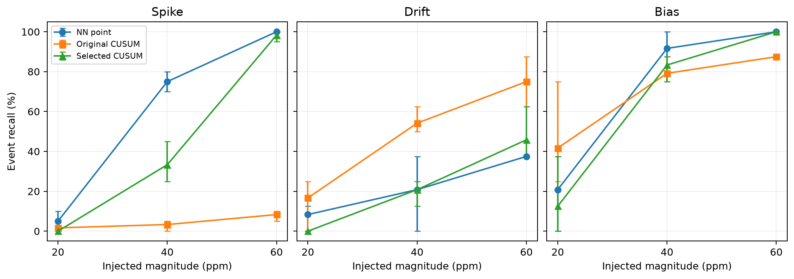

# CO2 sensor fault detection

This MMA3001 project compares simple rules, regression predictions and cumulative
residual monitoring for simulated CO2 spikes, gradual drifts and constant biases.
It uses one sensor from Dataset 2 MSI Occupancy and Environmental. The scope is
detection, without correcting readings or automatically classifying real faults.

The research is exploratory on a previously inspected period. A lower prediction
error does not guarantee better detection: predictions can follow faulty CO2
history, while CUSUM parameters trade abrupt departures against small sustained
residuals. An eight/six-input NN comparison tests this explanation and retains
counterexamples rather than assuming that removing history must improve detection.

Project stages and preserved historical versions are described in
[`CHANGELOG.md`](CHANGELOG.md).

## Start here

Run these English notebooks in order, from a fresh kernel for each notebook.

| Notebook | Purpose | What it produces |
|---|---|---|
| [01 Main experiment](notebooks/01_main_experiment.ipynb) | Train four prediction references, calibrate six detectors and evaluate identical faults | Default results, 63 sensitivity settings, predictions, event outcomes and timing |
| [02 NN input comparison](notebooks/02_nn_input_comparison.ipynb) | Compare eight inputs with six inputs excluding historical CO2 | Reproduction control, own validation limits, detection results and prediction-shift decomposition |
| [03 Results analysis](notebooks/03_results_analysis.ipynb) | Read both completed runs without training | Six-detector tables, placement ranges, amplitude plots, local mechanisms, delays and input-comparison findings |

Each notebook keeps training, calibration, spike injection, drift injection and
bias injection in separate explained cells. Shared calculation is in
[`src/co2_project`](src/co2_project). The experiment settings are in
[`config/study.json`](config/study.json).

## Environment

The reference environment uses Python 3.13 and the exact principal library
versions in `requirements.txt`. `requirements-lock.txt` records the full verified
environment. Create your own environment rather than copying a `.venv` folder.

```text
python -m venv .venv
```

Activate it (`.venv\Scripts\activate` on Windows, or `source .venv/bin/activate`
on a Unix shell), then run:

```text
python -m pip install -r requirements.txt
python -m ipykernel install --user --name co2-project --display-name "CO2 project"
```

The notebooks, tools and tests locate `src/` directly, so an editable installation
is optional. If desired, use `python -m pip install -e . --no-deps`; that standard
build step also needs setuptools. The verified notebook workflow does not depend
on an editable installation.

Open the project in VS Code, select the environment you installed, and run each
notebook from top to bottom. For command-line execution of all three:

```text
python tools/run_notebooks.py --kernel co2-project
```

## Authorized data

The original dataset is not bundled. The loader now accepts **either** the raw
course file `5EnvSensor_MayToDec2024_180kRows.csv` directly **or** a full-channel
long-format extract. No separate extraction step is required for the raw file.
Both routes select sensor `6012002000869` and require CO2, temperature and humidity.
A CO2-only `env_...csv` cannot supply the environmental model inputs.

For VS Code, copy `config/local.example.json` to `config/local.json` and replace
its `data_csv` value with your authorized file's actual path. This local file is
ignored by Git. For example (use forward slashes in JSON on Windows):

```json
{
  "data_csv": "D:/authorized-data/5EnvSensor_MayToDec2024_180kRows.csv"
}
```

Select the project's Python kernel and run notebooks 01, 02, then 03. Each notebook
reads that same setting, so no terminal environment setup is needed. After changing
Python source, restart any existing notebook kernel. Rerun 01 and 02 after this
input-support update before running 03; older saved runs lack prepared fingerprints.

Alternatively, set `CO2_DATA_CSV` in the process that launches the notebook kernel,
or place the authorized CSV at `data/input.csv`. Resolution priority is environment
variable, then local JSON, then `data/input.csv`. Relative configured paths are
resolved against the project root. A stale environment variable takes precedence
over local JSON. Setting a variable in a separate terminal does not update an
already-running VS Code kernel.

Raw input is streamed row by row. Only this sensor's three channels are retained
in memory. JSON Unix-second timestamps become UTC; identical duplicates are removed,
conflicts are rejected, and incomplete timestamps are excluded without interpolation.
The source stays read only. See [`data/README.md`](data/README.md) for schemas and
an optional standalone extraction command.

The actual raw file and the historical full extract produce **exactly identical**
prepared timestamps and numeric values. Their file hashes differ, so audit records
keep both the actual source SHA-256 and a format-independent prepared-data SHA-256.
Both notebook chains have been compared against the fixed reference results. This
does not extend the sensor, period or study protocol.

Keep raw data, local path settings and generated measurements out of submitted Git
history. See `.gitignore` and the final submission checklist.

## Run dependencies and private outputs

Notebook 01 registers its successfully completed directory in
`results/run_registry.json`. Notebook 02 explicitly reads that registered run,
checks data/splits/weights, then registers its own completion. Notebook 03 reads
both entries and checks their relationship. It does not choose a folder from its
modification time. Rerun 02 after replacing the registered main experiment.

`results/` is private and ignored by Git. It contains measurement-level fault
copies, labels, predictions, figures and executed notebooks. Recreate it from
authorized data; it is not required to be uploaded. The clean source notebooks
have no saved outputs. Do not turn a whole working-directory ZIP into a submission
after running experiments: use the reviewed files tracked by the final repository.

After interactive work, run `python tools/clear_notebook_outputs.py` before
reviewing the notebooks for a commit. Private executed copies remain under results.

[`results_summary/`](results_summary) contains only aggregate reference metrics
and reproducibility metadata. It supports inspection without redistributing
measurement-level course records. Summaries cannot regenerate the local event
plots; reproducing those requires authorized input and notebooks 01 and 02.

## Methods and fixed protocol

The four distinct prediction references are persistence, standardized OLS, a
depth-limited regression tree and a small NN. NN point detection, original NN plus
CUSUM and selected NN plus CUSUM share one NN prediction. Their alarms differ.

The main study uses eight inputs: CO2 lags 1 and 6, temperature, relative humidity,
UTC hour sine/cosine, weekend indicator and minutes since the preceding reading.
Complete history and continuity determine eligibility. The chronological counts
are 7,373 training, 2,458 validation and 2,458 test rows for the reference extract.
Scalers and model weights are fitted on the original training period only.

Point limits use unmodified validation absolute-residual Q99. Original CUSUM uses
training residual centring and a validation alert budget. The selected CUSUM uses
faulted validation copies for parameter development, before scoring test faults.
Changing units alone preserves CUSUM alarms; a scaling-equivalence control is kept.

Test placement seeds are 7, 42 and 99; they are distinct from the fixed NN training
seed 42. Magnitudes are 20, 40 and 60 ppm. Spikes last one reading; drift and bias
last 12, 24 or 48 readings, producing 63 settings. Magnitude comparisons reuse the
same windows and directions for a fixed seed and duration. Duration comparisons
can change windows. The six-input trial keeps identical eligible rows and training
settings; its validation-only limit-grid extension is documented in notebook 02.

## Tests and code documentation

```text
python -m pytest
python tools/build_docs.py
python tools/run_tests.py
```

The API reference is [`docs/api/index.html`](docs/api/index.html). Open it locally
in a browser; all pages include signatures, docstrings and inspectable source.
The generated test report is [`reports/test_report.html`](reports/test_report.html).
Unit tests use manufactured data. Integration tests require both completed local
runs and otherwise report a skip; they compare saved default and 63-case metrics
with the aggregate reference, including model-weight and parameter checks.

Implementation checks are separate from engineering validation. Passing tests does
not establish that every injected event will be found, or that real faults can be
distinguished from genuine environmental changes.

## Interpretation and limitations



This aggregate-only plot contains no measurement-level course records. At 40 ppm,
NN point detection finds 45/60 spikes and the selected CUSUM 20/60; at 60 ppm their
counts are 60/60 and 59/60. At 60 ppm over 24 readings, drift counts are 9/24,
18/24 and 11/24 for NN point, original CUSUM and selected CUSUM. The range bars
describe the three placement seeds, not confidence intervals.

An event hit requires one alarm during injection. Reading recall, paired additional
event hits, background alert burden, recovery alarms and matched-event delay answer
different questions. The original record is not independently verified truth.
Background alerts are not confirmed false positives. Missed-event delay is undefined,
and recovery alerts do not rescue active-event misses.

Three placement seeds share one record and are not independent real fault samples.
Their observed range is not a confidence interval. Training randomness, other
sensors, an untouched future period, correlated channel faults and physical CO2
ground truth remain outside this evidence. The small/long-drift input-comparison
counterexample is retained. The selected CUSUM does not dominate NN point detection
at moderate spikes.

## Assessment and AI disclosure

This repository supplies computational code and documentation. The personal report
and a ZIP of the final repository clone are separate Moodle deliverables under the
course brief. Before submission, the author must provide their identity, actual
repository access details and their own verification/learning reflection. See
[`reports/AI_USE.md`](reports/AI_USE.md) and
[`SUBMISSION_CHECKLIST.md`](SUBMISSION_CHECKLIST.md).

The assessment-use permission is in `LICENSE`; course data and third-party software
have separate terms. No public reuse license such as MIT has been assumed.
